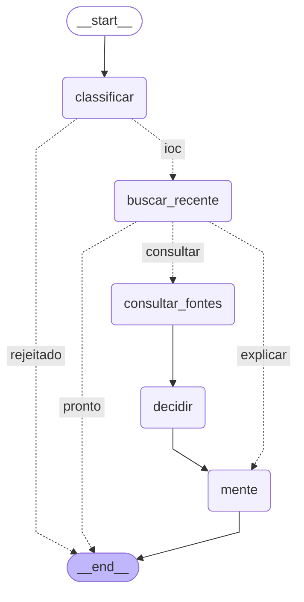

# Inóxio

Investigador de indicadores suspeitos. Você cola um IP, um domínio ou o hash de
um arquivo e recebe um veredito calculado por regra fixa a partir do VirusTotal
e do AbuseIPDB, com uma explicação em português escrita por uma IA que não
decide nada.

> *innoxius* (lat.): inofensivo. O veredito diz se o artefato é *noxius* ou
> *innoxius*.

Projeto da disciplina **Projeto Aplicado: Práticas de Mercado**
([escopo](https://github.com/ziraldocardoso/Projeto_aplicado-praticas_de_mercado/blob/main/Escopo_e_elementos_obrigatorios.md)).
Este README é o relatório técnico da entrega.

No ar em <https://179.199.133.136>.

## Como funciona

<!-- Gerado por `uv run python -m inoxio.investigacoes.desenhar`; um teste falha se divergir do grafo. -->
<!-- grafo:inicio -->

<!-- grafo:fim -->

- **Classificar:** a entrada só segue se for IP público, hash MD5/SHA-1/SHA-256
  ou domínio, ou o endereço de uma página (`https://exemplo.com/pagina`). O
  formato desarmado (`hxxps://exemplo[.]com`) também é aceito. O resto é recusado
  sem consultar nada.
- **Reaproveitar:** o mesmo indicador investigado há menos de 24 h devolve o
  resultado salvo, sem gastar a cota das fontes. A explicação da IA só é
  reaproveitada se foi escrita pela versão atual das instruções; senão, é escrita
  de novo. Resultado em que
  alguma fonte falhou nunca é reaproveitado.
- **Consultar e decidir:** VirusTotal e AbuseIPDB em paralelo. Para o endereço de
  uma página, o VirusTotal é consultado pela URL e pelo domínio dela, e vale o mais
  grave dos dois; a URL só é consultada, nunca enviada para análise. No VirusTotal,
  motores que marcam o indicador como *malicious* ou *suspicious* somam para
  `suspeito`; só os *malicious* (5 ou mais) levam a `malicioso`. Para um
  domínio, o DNS dá até dois IPs públicos, e o AbuseIPDB diz a reputação de cada
  um. Isso é só contexto: sites grandes ficam atrás de CDN, onde um IP serve
  milhares de domínios, então a fama do IP não entra no veredito. O servidor só
  consulta o DNS, nunca se conecta ao site. O veredito
  (`malicioso`, `suspeito`, `sem_evidencia`, `desconhecido` ou `inconclusivo`) e
  a nota de risco (0 a 100: a partir de 25 é suspeito, a partir de 75 é
  malicioso) saem de regras fixas em `src/inoxio/investigacoes/decidir.py`. Se
  uma fonte falha, o resultado é `inconclusivo`, nunca "sem evidência".
- **Mente:** um LLM no Groq lê os resultados e devolve, para quem não é da área,
  um resumo em linguagem simples, um parágrafo sobre o que cada fonte mostrou, um
  glossário dos termos que aparecem (o provedor do IP, como a Cloudflare, por
  exemplo), recomendações práticas e as técnicas MITRE ATT&CK, num esquema fixo.
  Item que passa de um limite (lista longa demais, texto grande demais, código
  MITRE inválido) sai sozinho, e o resto da explicação continua. Ele não tem ferramentas e o esquema
  não tem campo de veredito. As recomendações são para uma pessoa comum, sem
  termos técnicos. Sem evidência não é garantia: toda frase que chama o indicador
  de seguro, limpo, legítimo, confiável ou "normal", que diz não haver motivo para
  suspeitar, se preocupar ou bloquear, ou que afirma que algo não é malicioso, sai
  do resumo, dos parágrafos por fonte, das recomendações e do glossário. Negar é
  aviso e fica ("não é seguro", "não é um site confiável"), assim como conselho
  ("senha segura"). Termo do glossário que fica sem significado sai da lista, e
  se o resumo inteiro sai, a tela segue sem a análise. A explicação é escrita em segundo
  plano, uma chamada ao Groq por vez: se o provedor recusa por limite (429), ela
  espera e tenta de novo; se recusa o JSON, tenta mais uma vez. Só o resumo é obrigatório no formato pedido, e os campos mais valiosos vêm primeiro: se o modelo para no meio, o que veio antes ainda vira explicação. Se mesmo assim ela fica indisponível, a tela oferece "Tentar explicar de novo" (sem gastar crédito; no máximo 10 vezes por hora). Se o Groq
  falhar ou demorar mais de 10 s, a tela também mostra o resultado sem a análise.

## Telas

- **Página inicial** (`/`), pública: o que o produto faz, uma vitrine com um resultado
  real (google.com, investigado em produção), como funciona, o que a pessoa recebe e
  os planos. Os planos são ilustrativos: nada é vendido, porque as APIs gratuitas do
  VirusTotal e do AbuseIPDB não permitem uso comercial. "Pedir demonstração" só abre
  um e-mail para o contato da Política de Privacidade; sem contato configurado, os
  planos pagos aparecem como "Em breve". As cores seguem o tema claro ou escuro.
- **Entrar ou criar conta** (`/entrar` e `/cadastro`): uma foto à esquerda e, à direita,
  um cartão com as abas Entrar e Criar conta (cada aba tem o próprio endereço). O
  cadastro pede nome, e-mail e senha e exige aceitar os Termos de Uso e a Política de
  Privacidade, que abrem numa janela por cima da tela, sem perder o que foi digitado.
  A foto é do Pexels (licença Pexels, uso livre, sem crédito obrigatório):
  https://www.pexels.com/photo/black-notebook-on-white-surface-7793163/.
  A conta só entra depois de confirmar o e-mail pelo link (válido por 24 h) e começa
  com 10 créditos por dia: cada investigação usa um, e eles voltam à meia-noite,
  horário de Brasília.
- **Esqueci minha senha** (`/esqueci-senha`), pelo link do login: manda para o e-mail
  da conta um link de 1 hora que abre a tela de senha nova (`/redefinir`).
- **Termos de Uso** (`/termos`) e **Política de Privacidade** (`/privacidade`),
  públicas, com links no rodapé de todas as telas.
- **Primeiro acesso:** uma apresentação em quatro passos explica o que o sistema faz,
  como investigar, como ler o resultado e o papel da IA. Aparece uma vez por conta.
  Quem ainda não aceitou a versão atual dos termos aceita antes, numa janela que não
  deixa seguir sem o aceite.
- **Minha conta** (`/conta`), pelo nome no topo: os dados da conta, o nome de
  exibição (o login continua o mesmo), a troca de senha (pede a atual; as outras
  sessões caem) e de e-mail (só vale depois do clique no link mandado ao e-mail novo;
  o antigo recebe um aviso), o download de tudo o que o sistema guarda sobre a pessoa
  e a exclusão da conta, confirmada pela senha. O papel só o admin muda.
- **Casca do app:** menu à esquerda (vira uma faixa no topo no celular), com a
  Administração abrindo na Visão geral e mostrando Usuários e Auditoria embaixo dela;
  breadcrumb e botão Voltar em toda tela; créditos de hoje no topo, com a explicação
  numa dica; e o botão de modo escuro ou claro, que fica salvo no navegador. Com a
  sessão aberta, o logo e o endereço `/` levam ao Início: a página pública e o login
  só voltam depois de sair ou de a sessão vencer (1 hora sem uso, ou 8 horas no
  total). As datas aparecem no horário de Brasília (DD/MM/AAAA hh:mm:ss). As telas e
  quem é filho de quem ficam numa lista só, em `frontend/src/app/navegacao.tsx`.
- **Início** (`/inicio`; o endereço antigo `/painel` leva a ele): boas-vindas pelo nome, créditos restantes e os números do usuário, gráficos das
  investigações dos últimos 14 dias por veredito, da divisão por veredito e por tipo
  de indicador, as ameaças encontradas, os 10 indicadores mais pesquisados, o campo
  para investigar e as 5 investigações mais recentes. Os gráficos são SVG e CSS
  desenhados no próprio app, sem biblioteca a mais.
- **Investigações** (`/investigacoes`): todas as do usuário, da mais nova para a
  mais antiga, 5 por página, com busca pelo indicador.
- **Investigação:** veredito com a nota num medidor, a explicação em linguagem
  simples com o que cada fonte mostrou, o glossário e o que fazer, as evidências de cada fonte e os IPs do
  site com quem opera cada um (todos os IPs do DNS, até 50, em páginas de 5; só os 2
  primeiros são consultados no AbuseIPDB, para poupar a cota). As técnicas MITRE ATT&CK ficam em "Para analistas".
  Quando os IPs são de uma empresa conhecida (Cloudflare, Akamai, Fastly, Google,
  Amazon, Microsoft), o cartão "Quem opera estes IPs" explica em linguagem simples
  por que o IP é dela, com texto fixo do app, sem depender da IA.
- **Usuários:** só para o papel `admin`: a lista em páginas de 10, com busca (usuário,
  nome ou e-mail) e filtro por papel e situação; "Novo usuário" e "Editar" abrem numa
  janela. O admin cadastra, edita (papel, cota e senha), zera o uso de hoje, encerra
  as sessões, desativa e reativa usuários por ali. O
  admin não tem cota diária. O cadastro também existe no terminal, com
  `inoxio criar-usuario`. Ninguém desativa a própria conta, e o último admin
  ativo não perde o papel.
- **Visão geral** (`/visao-geral`), só para o `admin`, a casa da administração:
  atalhos para Usuários e Auditoria, contas por situação (ativas, desativadas,
  aguardando e-mail, recusadas), quem não usou nos últimos 30 dias, total de
  investigações e de sites pesquisados, e os 10 usuários que mais pesquisam.
- **Auditoria** (`/auditoria`), só para o `admin`: uma tabela por usuário, com os
  mesmos filtros da tela de Usuários, 10 por página; o botão Visualizar abre as
  sessões da pessoa, 5 por página, com filtro por período e a linha do tempo de cada
  uma, do login ao fim (saiu, venceu, encerrada pelo admin), e os eventos de fora de
  sessão (senha errada, cadastro, link de senha), também 5 por página. Toda lista
  mostra a paginação, mesmo com uma página só, e o carregando enquanto a página pedida
  não chega. Guarda 90 dias.

## LGPD

A Política de Privacidade diz o que é tratado, a base legal de cada uso, com quem
os dados são compartilhados (VirusTotal, AbuseIPDB, Groq, Gmail e a hospedagem) e
por quanto tempo ficam. Os direitos do titular (art. 18) estão na própria conta:

- **Acesso:** a página Minha conta mostra os dados guardados.
- **Correção:** o nome de exibição, o e-mail e a senha se corrigem em Minha conta.
- **Portabilidade:** `GET /api/conta/dados` devolve um JSON com a conta, as
  investigações e os eventos de segurança da pessoa, e nada de outra conta nem o
  hash da senha.
- **Exclusão:** `POST /api/conta/excluir`, com a senha e o token CSRF, apaga a conta,
  as investigações, as sessões, as ativações, os pedidos de senha nova e as tentativas de login. Os eventos de
  auditoria ficam pelos 90 dias, sem o nome, inclusive no texto dos eventos do admin
  que cadastrou ou alterou a conta. Fica um evento `conta_excluida`, também sem nome.
  O último admin ativo não se exclui.

O aceite guarda a versão e a data (`termos_versao`, `termos_aceitos_em`). A versão
tem uma fonte só, `VERSAO_TERMOS` em `src/inoxio/contas/regras.py`, e o frontend a lê
de `/api/publico`. Mudar a versão faz todo mundo aceitar de novo no próximo acesso.
O e-mail de contato para pedidos sobre dados vem de `INOXIO_CONTATO_PRIVACIDADE`.

## Stack

FastAPI + LangGraph (Python 3.12) na API, React 19 + Ant Design 6 no frontend,
SQLite com SQLAlchemy, Groq (`openai/gpt-oss-20b`) para a IA.

```
src/inoxio/
  investigacoes/  o contexto central: classificar, consultar as fontes, decidir o
                  veredito pelas regras, o grafo, o histórico e as estatísticas
    fontes/       AbuseIPDB, VirusTotal e DNS, uma por arquivo
    ia/           a explicação pela IA: esquema, instruções, filtro e o explicador
  contas/         cadastro, senhas, sessões, limites de login, troca de e-mail,
                  administração e exclusão; rotas/ com as rotas HTTP
  auditoria/      a trilha de eventos e a linha do tempo de cada usuário
  plataforma/     o que não é regra de negócio: configuração, banco, e-mail,
                  paginação, horário de Brasília e endereço de origem
  web/            a montagem do app e as dependências de acesso
frontend/src/
  app/            a casca: rotas, mapa das telas, menu, topo, tema e a sessão
  compartilhado/  API, tipos, formatos, ícones, janela, paginação e carregamento
  publico/        a página inicial (landing/) e os documentos legais (documentos/)
  acesso/         entrar, criar conta, ativar, senha esquecida, termos e apresentação
  investigacoes/  o painel (painel/), a lista e o resultado de cada uma (investigacao/)
  conta/          Minha conta: perfil, e-mail, senha, dados e exclusão
  administracao/  visão geral, usuários (usuarios/) e auditoria (auditoria/)
infra/            Nginx da borda, Fail2Ban, Certbot e o script de deploy
tests/            testes do backend (pytest); os do frontend ficam ao lado das telas
```

## OWASP Top 10:2025

Os três itens escolhidos, onde cada controle está no código e o teste que
falha se ele for removido.

### A01 Broken Access Control

| Controle | Onde | Teste |
| --- | --- | --- |
| Toda rota da API, fora login e sessão, exige sessão válida | `sessao_atual` em `src/inoxio/web/dependencias.py` | `test_autenticacao.py::test_rotas_protegidas_sem_sessao_sao_401` |
| Cada usuário só lista as próprias investigações; abrir a de outro responde 404, sem revelar que ela existe. Só o papel `admin` abre qualquer uma | `listar` e `ver` em `src/inoxio/investigacoes/rotas.py` | `test_web_agente.py::test_lista_so_as_investigacoes_do_proprio_usuario`, `::test_investigacao_de_outro_usuario_e_404`, `::test_admin_ve_investigacao_de_qualquer_um` |
| Cadastro e lista de usuários só para o papel `admin`, que nunca vê o hash das senhas | `exigir_admin` em `src/inoxio/web/dependencias.py`; `src/inoxio/contas/rotas/usuarios.py` | `test_usuarios.py::test_analista_nao_lista_nem_cadastra`, `::test_admin_lista_sem_expor_hash` |
| Trilha de auditoria lida só pelo `admin`; a alteração de senha entra como "senha trocada", nunca o valor; o admin abrindo investigação de outra pessoa fica registrado | `src/inoxio/auditoria/trilha.py`, `auditoria_por_usuario` em `src/inoxio/auditoria/rotas.py` | `test_auditoria.py` |
| Minha conta só mostra, exporta e exclui a conta da própria sessão; a exclusão pede a senha de novo, para uma sessão esquecida aberta não bastar | `src/inoxio/contas/rotas/conta.py`, `excluir` em `src/inoxio/contas/exclusao.py` | `test_conta.py::test_baixar_meus_dados_traz_so_o_que_e_meu`, `::test_excluir_exige_a_senha_e_o_csrf`, `::test_excluir_tira_o_nome_do_detalhe_dos_eventos_do_admin` |
| Escrita exige o token CSRF da sessão no cabeçalho `X-CSRF-Token`, comparado em tempo constante | `conferir_csrf` em `src/inoxio/web/dependencias.py`; o frontend envia em `frontend/src/compartilhado/api.ts` | `test_web_agente.py::test_post_sem_csrf_e_recusado`, `test_autenticacao.py::test_logout_sem_csrf_e_recusado` |
| A API só aceita corpo JSON, o que barra formulário vindo de outro site | modelos Pydantic em `src/inoxio/contas/rotas/autenticacao.py` | `test_autenticacao.py::test_login_por_formulario_e_recusado` |

### A05 Injection

| Controle | Onde | Teste |
| --- | --- | --- |
| A entrada é validada por tipo (IP público, hash, domínio) antes de qualquer uso; o valor usado nas consultas é o normalizado, sem zona IPv6 (`%...`) nem IPv4 embutido em NAT64; de um endereço de site sai só o host, e só de `http`/`https` | `classificar_entrada` em `src/inoxio/investigacoes/classificar.py` | `test_classificar.py::test_entradas_recusadas`, `test_grafo.py::test_argumento_da_consulta_vem_do_classificar` |
| SQL só por SQLAlchemy, sempre parametrizado; não há SQL montado com texto em `src/` | `src/inoxio/plataforma/banco.py`, os `modelos.py` de cada contexto e as consultas em `src/inoxio/` | `test_grafo.py::test_entrada_rejeitada_nao_consulta_nada` (a entrada `' OR 1=1--` é recusada antes do banco) |
| O app não executa processo nem shell | todo `src/inoxio/` | `test_arquitetura.py::test_nenhum_argumento_shell`, `::test_app_nao_executa_processo` |
| O React nunca injeta HTML, e a CSP só aceita script próprio e estilo com nonce novo a cada resposta | a borda (`infra/borda/nginx.conf`), `frontend/src/main.tsx` | `frontend/src/arquitetura.test.ts` ("o React nunca injeta HTML"), `infra/ensaio-local/testar.sh` ("nonce novo a cada resposta") |
| Texto vindo das fontes vai para a IA marcado como não confiável; a IA não tem ferramentas e não decide o veredito | `src/inoxio/investigacoes/ia/`, `src/inoxio/investigacoes/decidir.py` | `test_grafo.py::test_injecao_nas_tags_nao_muda_o_veredito`, `test_arquitetura.py::test_mente_nao_tem_tools_nem_campo_de_veredito` |

### A07 Authentication Failures

| Controle | Onde | Teste |
| --- | --- | --- |
| Senhas com argon2id, mínimo de 12 caracteres | `src/inoxio/contas/credenciais.py` | `test_senhas.py::test_hash_e_argon2id`, `::test_senha_curta_e_recusada` |
| Usuário inexistente e senha errada dão a mesma resposta; o inexistente também passa pelo argon2, para o tempo não denunciar quem existe | `_HASH_FALSO` em `credenciais.py`; `entrar` em `src/inoxio/contas/rotas/autenticacao.py` | `test_autenticacao.py::test_usuario_inexistente_e_senha_errada_respondem_igual` |
| Bloqueio de 15 min após 5 falhas da mesma conta vindas do mesmo IP, ou 20 falhas de um IP em qualquer conta (IPv6 conta pela rede /64); senhas erradas de outro IP não trancam o dono, até o teto de 100 falhas da conta somando todos os IPs; tentativas em paralelo não furam o limite; um `X-Forwarded-For` forjado não troca o IP | `src/inoxio/contas/tentativas.py`; `entrar` em `src/inoxio/contas/rotas/autenticacao.py`; `ProxyHeadersMiddleware` em `src/inoxio/web/app.py` | `test_limites_login.py` |
| Sessão no servidor: o banco guarda só o SHA-256 do token; cookie `__Host-`, `HttpOnly`, `Secure`, `SameSite=Strict` | `src/inoxio/contas/sessoes.py` | `test_autenticacao.py::test_banco_guarda_so_o_hash_do_token`, `::test_cookie_de_sessao_protegido` |
| Cadastro público: o link de ativação leva o token depois do `#` (não chega ao servidor nem ao log), vale 24 h, só ativa conta que ainda espera o e-mail e sai do banco depois de usado; e-mail já cadastrado responde igual a um cadastro novo, para não revelar quem tem conta, e, se a conta ainda espera a confirmação, o dono do e-mail recebe um link novo que cancela o anterior; no máximo 5 cadastros por IP por hora | `src/inoxio/contas/rotas/cadastro.py`, `abrir_ativacao` e `ativar` em `src/inoxio/contas/registro.py` | `test_cadastro.py` |
| Esqueci a senha: a resposta é a mesma com ou sem conta; só conta ativa com e-mail confirmado recebe o link, com o token depois do `#`, válido por 1 hora e de uso único; um pedido de outra pessoa não derruba o link que a dona pediu, e trocar a senha invalida todos; senha curta é recusada sem gastar o link; a troca derruba as sessões abertas; no máximo 5 pedidos por IP e 3 e-mails por conta por hora, e o e-mail digitado não entra na auditoria | `src/inoxio/contas/rotas/senha.py`, `abrir_redefinicao` e `redefinir_senha` em `src/inoxio/contas/credenciais.py` | `test_esqueci_senha.py` |
| Conta desativada não entra (mesma resposta de senha errada) e perde as sessões abertas; senha trocada pelo admin também derruba as sessões | `alterar` em `src/inoxio/contas/administracao.py`; `validar` em `src/inoxio/contas/sessoes.py` | `test_usuarios.py::test_desativado_nao_entra_e_perde_a_sessao_aberta`, `::test_senha_nova_derruba_as_sessoes_e_so_ela_vale` |
| Token novo a cada login, expiração por 1 h sem uso ou 8 h de duração, logout que apaga a sessão no servidor | `sessoes.py`; `entrar` e `sair` em `autenticacao.py` | `test_autenticacao.py::test_login_troca_o_token_e_fecha_o_antigo`, `::test_sessao_ociosa_expira_depois_de_1_hora`, `::test_logout_invalida_no_servidor` |

Além dos três, o código também trata A10 (Mishandling of Exceptional
Conditions: falha de fonte vira `inconclusivo`, e erro 500 não mostra stack
trace) e A03 (Software Supply Chain Failures: dependências travadas em
`uv.lock` e `package-lock.json`, `npm ci --ignore-scripts` e Actions fixadas por
SHA).

## Infraestrutura

VPS na Hostinger com Ubuntu Server 24.04.4 LTS.

- **Borda:** Nginx 1.30 (`infra/borda/`) nas portas 80 e 443. A porta 80 só
  atende o desafio do Let's Encrypt e redireciona o resto para HTTPS com `301`.
  Na 443, o Nginx lê o nome pedido no TLS sem abrir a conexão: o acesso pelo IP
  é terminado nele; qualquer outro nome segue para o outro sistema da máquina.
- **Frontend:** a borda serve o React direto do disco (`/home/inoxio/frontend/atual`,
  montado só para leitura). A cada resposta da página ela põe um nonce novo no
  cabeçalho CSP e na meta tag que o antd lê, e marca a versão publicada (o SHA do
  commit) na página e nas respostas da API (`X-Inoxio-Versao`); a aba aberta antes
  de um deploy recarrega na navegação seguinte. Só `/api/` e `/saude` chegam ao app.
- **Limite de requisições:** a borda aceita até 10 requisições por segundo por
  IP (com folga de 40) e 10 tentativas de login por minuto (folga de 5). Acima
  disso responde `429` em JSON, antes de chegar ao app.
- **TLS:** TLS 1.3 e 1.2, com troca de chaves pós-quântica `X25519MLKEM768`
  como preferida. Certificado do Let's Encrypt emitido para o IP, no perfil de
  curta duração (cerca de 6 dias).
- **Certbot:** versão 5.8, instalada por pip em `/opt/certbot` porque a VPS não
  tem snap. A renovação roda duas vezes por dia pelo timer
  `infra/certbot/certbot-renova.timer`; o `certbot renew --dry-run` passou.
- **SSH:** só por chave (`PasswordAuthentication no`). Fail2Ban na porta 22 com 4
  erros e banimento de 24 h (`infra/fail2ban/sshd.local`). A jail lê o journal
  de `ssh.service`, o nome do serviço no Ubuntu 24.04; até 24/10/2026 lia o de
  `sshd.service`, vazio, e nunca tinha banido ninguém. Conferido com cinco logins
  falhos de um container: o quinto já foi recusado e o IP entrou na lista.
- **Firewall:** UFW negando toda entrada por padrão; abertas só a 22, a 80 e a
  443 (mais a do outro sistema, ver os desvios).
- **App:** uvicorn ouvindo só em `127.0.0.1:8100`, rodando como o usuário
  `inoxio`, sem `sudo` nem `docker`, numa unidade `systemctl --user` com
  `NoNewPrivileges` (`infra/implantacao/inoxio.service`). As chaves das APIs
  ficam em `~/.config/inoxio/env`, com modo 600, fora do repositório.

Resultado dos testes de TLS no endereço `179.199.133.136`, refeitos em 25/10/2026
com o certificado renovado sozinho em 24/10 (válido até 31/10). Os de 26/09 e de
24/10/2026, com os certificados anteriores, deram o mesmo resultado:

- [SSL.org](https://www.ssl.org/): *Certificate Trusted: Yes*; *Name Matches Domain:
  Yes*; cadeia *Valid · Complete* até a ISRG Root X2; TLS 1.2 e 1.3; *sha384 / EC 256
  bits · Good signature · Good key* (o escopo pede pelo menos *Acceptable key*);
  *Certificate Transparency: Compliant*.
- [DigiCert PQC checker](https://www.digicert.com/pqc-checker): *Pass* nas duas
  verificações, *TLS 1.3 enabled* e *Quantum-safe key exchange* (`X25519MLKEM768`,
  conferido também com `openssl s_client -groups X25519MLKEM768`).

## Observabilidade

Um Grafana (`infra/observabilidade/`) lê o banco SQLite do app em modo somente
leitura e mostra investigações por dia, vereditos, logins certos e errados, contas
ativas e pendentes, os indicadores mais pesquisados e os últimos eventos da
auditoria. Ele escuta só em `127.0.0.1:3000` da VPS, sem porta nova na internet;
o acesso é por túnel SSH:

```bash
ssh -L 3000:127.0.0.1:3000 <usuario>@179.199.133.136
```

Depois, abra http://localhost:3000. As consultas do painel são testadas contra o
esquema real do banco (`tests/test_observabilidade.py`).

## Backup

Todo dia, um timer do systemd do usuário `inoxio` roda
`infra/backup/backup-banco.py`. Ele copia o banco pela API de backup do SQLite
(cópia consistente mesmo com o app gravando), confere a cópia com
`PRAGMA integrity_check`, guarda comprimida em `~/backups` com modo 600, mantém as
14 mais recentes e registra um evento `backup` na auditoria. O Grafana mostra as
horas desde o último backup (laranja a partir de 26 h, vermelho a partir de 48 h).
As cópias ficam no disco da própria VPS: protegem contra corrupção e erro humano,
não contra a perda da máquina.

Para restaurar, com o serviço parado:

```bash
gunzip -c ~/backups/inoxio-AAAAMMDD-HHMMSS.db.gz > ~/dados/inoxio.db
```

## Deploy

Cada `git push origin main` dispara `.github/workflows/implantar.yml`:

1. **testar:** `ruff`, `pytest`, os testes do React (`vitest`) e o build.
2. **implantar:** só roda se o primeiro passar. Compila o frontend e manda o
   pacote por SSH para a VPS, junto com o SHA do commit.

Na VPS, a chave do CI está presa a um único comando no `authorized_keys`
(`restrict,command="/home/inoxio/bin/implantar"`): ela não abre shell nem túnel.
O script `infra/implantacao/implantar` recusa o que não for um SHA de 40
hexadecimais e o pacote que tiver link, arquivo especial ou mais de 100 MB
descompactado, faz o checkout do commit, instala as
dependências com `uv sync --frozen`, troca o link do frontend (a borda passa a
servir o novo na hora, sem recarregar), reinicia o serviço e confere o `/saude`. Se o app não responder, volta para a versão anterior.

A chave privada e o `known_hosts` ficam nos Secrets do environment `producao`
(`INOXIO_SSH_KEY`, `INOXIO_SSH_KNOWN_HOSTS`). O workflow tem permissão só de
leitura no repositório e usa as Actions fixadas por SHA.

## Conta e repositório

- Conta GitHub gratuita com 2FA; `commit` e `push` por chave SSH.
- Repositório público com *secret scanning* e *push protection* ligados.
- O `.gitignore` bloqueia `.env`, chaves, certificados e bancos locais. O
  modelo das variáveis está em `.env.example`, sem nenhum valor.

## Rodando localmente

Precisa de Python 3.12 com [uv](https://docs.astral.sh/uv/) e Node 22. Os comandos
valem no Linux, no macOS e no PowerShell do Windows.

**1. Configuração.** Na pasta do projeto:

```bash
uv sync
cp .env.example .env
```

Abra o `.env` e preencha as chaves que tiver: o próprio arquivo diz onde criar cada
uma (as três têm plano gratuito). Nenhuma é obrigatória para o app subir; sem elas,
toda investigação sai `Inconclusivo`.

**2. O primeiro usuário.** O comando pede a senha duas vezes (mínimo de 12 caracteres):

```bash
uv run --env-file .env inoxio criar-usuario seu_nome --papel admin
```

**3. A API.** Num terminal, deixe rodando:

```bash
uv run --env-file .env uvicorn inoxio.web.app:criar_app --factory
```

**4. A tela.** Em outro terminal, na pasta `frontend`:

```bash
npm ci
npm run dev
```

Abra <http://localhost:5173> e entre com o usuário do passo 2. O Vite serve o React
e repassa `/api` para o uvicorn da porta 8000. Use `localhost`, não `127.0.0.1`: em
algumas máquinas o Vite escuta só no endereço IPv6 do `localhost`.

Em produção quem serve o React é a borda; o ensaio dela
(`infra/ensaio-local/testar.sh`) confere a página, o nonce e a versão.

Testes: `uv run pytest` e, em `frontend/`, `npm test`.

## Uso de IA

Como pede o escopo, o desenvolvimento e a auditoria do código usaram IA: o
**Claude Code**, no lugar do Google Antigravity recomendado, para escrever e
revisar o código e a segurança.

## Desvios declarados

- **Free Tier:** a aplicação roda numa VPS paga que já existia, compartilhada
  com outro sistema do autor, e não num nível gratuito de nuvem. O Nginx da
  borda separa o tráfego dos dois pelo nome pedido na conexão TLS.
- **Versão do sistema:** a VPS usa o Ubuntu Server 24.04.4 LTS, que é a versão
  em que ela já estava, e não a LTS mais recente.
- **Porta de outro sistema:** há uma porta UDP aberta na mesma máquina que
  pertence a esse outro sistema. O Inóxio expõe só a 80 e a 443, além da 22.
